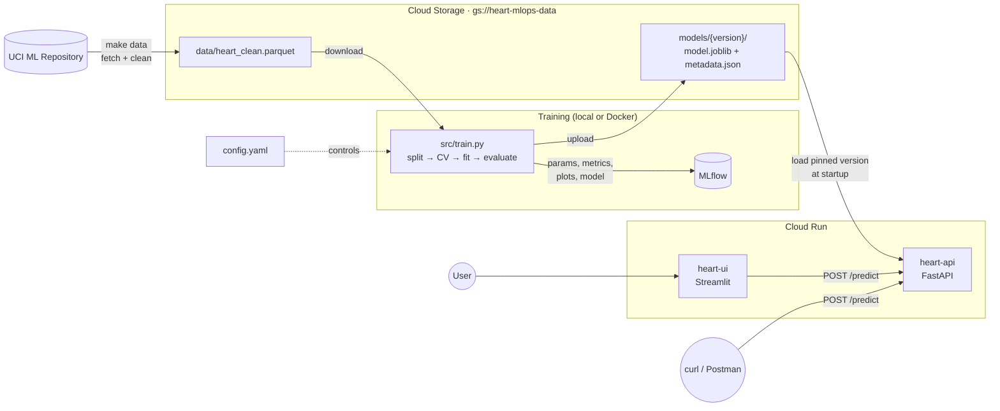
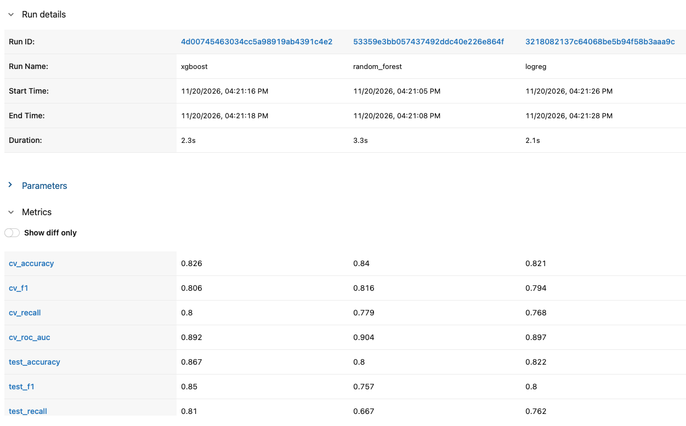
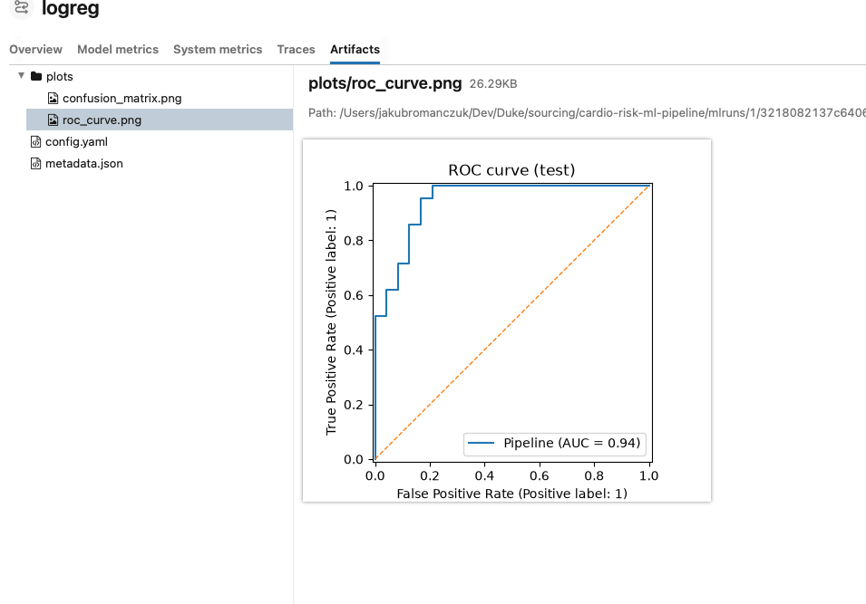
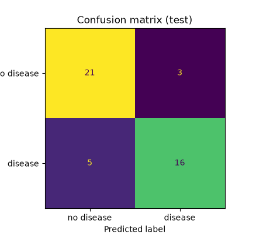
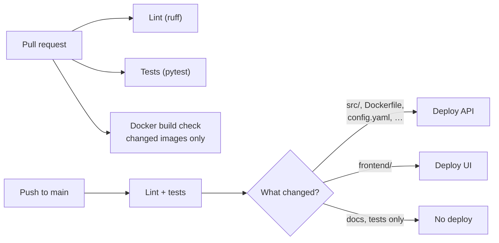

# Heart Disease Risk — MLOps Pipeline

[](https://github.com/kromanczuk/cardio-risk-ml-pipeline/actions/workflows/ci.yml)

Predicts whether a patient has heart disease from 13 clinical measurements — built as an
end-to-end, reproducible ML system on Google Cloud.

| | Live |
|---|---|
| **Front-end** | **https://heart-ui-cgtpmpv5ca-ue.a.run.app** |
| **API docs** (try `/predict` in the browser) | https://heart-api-cgtpmpv5ca-ue.a.run.app/docs |
| API health | https://heart-api-cgtpmpv5ca-ue.a.run.app/health |

> Services scale to zero, so the first request after a quiet period takes ~10 s.
> Class project — predictions are not medical advice.

**Contents:** [Overview](#overview) · [Architecture](#architecture) · [Dataset](#dataset) ·
[Model and evaluation](#model-and-evaluation) · [Cloud services](#cloud-services) ·
[Quickstart](#quickstart) · [Usage](#usage) · [Deploy](#deploy-to-google-cloud) ·
[CI/CD](#cicd) · [API reference](#api-reference) · [Security](#security) · [Team](#team)

## Overview

**Task:** binary classification — heart disease (1) or not (0). **Primary metric:** ROC-AUC.

The focus is the MLOps lifecycle, not squeezing out accuracy:

- **Reproducible** — `config.yaml` controls data paths, split, seed, model type and
  hyperparameters; dependencies are pinned; everything runs in Docker.
- **Tracked** — every training run logs parameters, metrics, plots and the model to MLflow.
- **Versioned** — each model is stored in GCS under its own version; production serves the
  version pinned in `config.yaml`, so promoting or rolling back is a one-line PR.
- **Deployed** — public API and front-end on Cloud Run, redeployed by CI only when their
  code changes.

## Architecture



The model is saved as **one scikit-learn `Pipeline`** (preprocessing + classifier), so the
API applies exactly the preprocessing used in training — no duplicated feature code to drift.

## Dataset

[**UCI Heart Disease — Cleveland**](https://archive.ics.uci.edu/dataset/45/heart+disease)
(UCI id 45): 303 patients, 13 features (6 numeric, 3 binary, 4 categorical).

- **Cleaning:** 6 rows with missing `ca`/`thal` dropped → **297 rows**; original UCI
  encodings kept.
- **Target:** `target = 1` if the original `num` (0–4, disease severity) > 0.
  Balanced: 160 no disease / 137 disease.
- **Storage:** [`scripts/upload_to_gcs.py`](scripts/upload_to_gcs.py) fetches, cleans and
  uploads it to GCS; [`src/data_loader.py`](src/data_loader.py) downloads it in the pipeline.

<details>
<summary><b>Feature list</b></summary>

| Feature | Type | Meaning |
|---|---|---|
| `age` | numeric | Age in years |
| `trestbps` | numeric | Resting blood pressure (mm Hg) |
| `chol` | numeric | Serum cholesterol (mg/dl) |
| `thalach` | numeric | Maximum heart rate achieved |
| `oldpeak` | numeric | ST depression induced by exercise |
| `ca` | numeric | Major vessels colored by fluoroscopy (0–3) |
| `sex` | binary | 0 = female, 1 = male |
| `fbs` | binary | Fasting blood sugar > 120 mg/dl |
| `exang` | binary | Exercise-induced angina |
| `cp` | categorical | Chest pain: 1 typical angina, 2 atypical, 3 non-anginal, 4 asymptomatic |
| `restecg` | categorical | Resting ECG: 0 normal, 1 ST-T abnormality, 2 LV hypertrophy |
| `slope` | categorical | Peak exercise ST slope: 1 up, 2 flat, 3 down |
| `thal` | categorical | Thalassemia: 3 normal, 6 fixed defect, 7 reversible defect |

</details>

## Model and evaluation

[`src/train.py`](src/train.py) runs: **load data from GCS → stratified 70/15/15
train/val/test split → preprocessing (scale numeric, one-hot categorical) → 5-fold CV on
train → fit → evaluate on val and test → log to MLflow → upload model to GCS.**
Three model types can be selected in `config.yaml`:

| Model | CV ROC-AUC | Val ROC-AUC | **Test ROC-AUC** | Test F1 | Test recall | Test accuracy |
|---|---|---|---|---|---|---|
| **Logistic regression** (served) | 0.897 | 0.915 | **0.944** | 0.800 | 0.762 | 0.822 |
| Random forest | 0.904 | 0.927 | 0.925 | 0.757 | 0.667 | 0.800 |
| XGBoost | 0.892 | 0.913 | 0.909 | 0.850 | 0.810 | 0.867 |

**Why logistic regression?** With 45 test patients the models are within noise of each other.
Logistic regression has the best test ROC-AUC and is the simplest and most interpretable.
XGBoost scores higher on F1/accuracy at the default 0.5 threshold, but ROC-AUC is our primary
metric because it measures risk *ranking* across all thresholds.

**MLflow** — the three runs compared, and the served run's logged artifacts:






## Cloud services

| Service | Used for |
|---|---|
| **Cloud Storage** | Cleaned dataset and versioned model artifacts (`gs://heart-mlops-data`) |
| **Cloud Run** | Hosting the API (`heart-api`) and front-end (`heart-ui`); scale to zero |
| **Artifact Registry** | Docker images, tagged with the git commit they were built from |
| **IAM + Workload Identity Federation** | Least-privilege runtime account; keyless deploys from GitHub Actions |
| **GitHub Actions** | Lint, tests, Docker build checks, path-based deploys |
| **MLflow** (local, SQLite) | Experiment tracking |

## Quickstart

Requires Python 3.12 and Docker ([Colima](https://github.com/abiosoft/colima) works too).

```bash
git clone https://github.com/kromanczuk/cardio-risk-ml-pipeline.git && cd cardio-risk-ml-pipeline
python3.12 -m venv .venv && source .venv/bin/activate
pip install -r requirements.txt
```

**Without access to our GCP project** (the bucket is private), the whole pipeline runs
offline — data comes straight from UCI:

```bash
python scripts/upload_to_gcs.py --local data/heart_clean.parquet          # fetch + clean
python -m src.train --local-data data/heart_clean.parquet --no-upload     # train, log to MLflow
MODEL_URI=artifacts make api                                              # serve that model
```

**With access**, log in once and use the `make` targets below:
`gcloud auth application-default login`.

## Usage

Every step has a `make` target; see the [`Makefile`](Makefile) for the underlying commands.

| Step | Command | Result |
|---|---|---|
| Data | `make data` | Fetch from UCI, clean, upload to GCS |
| | `make download` | Download the cleaned data to `data/heart_clean.parquet` |
| Train | `make train` | Train `model.type` from `config.yaml`, upload to GCS |
| | `make train MODEL=xgboost` | `logreg` \| `random_forest` \| `xgboost` |
| | `make train-all` | One run per model type, to compare in MLflow |
| Track | `make mlflow-ui` | MLflow at http://127.0.0.1:5000 (experiment `cardio-risk`) |
| API | `make api` | http://127.0.0.1:8000/docs (model from GCS) |
| Front-end | `make ui` | http://127.0.0.1:8501, calling the local API |
| | `make ui API_URL=<url>` | …calling any API, e.g. the deployed one |
| Tests | `make test` / `make lint` | pytest (dummy model, no GCS) / ruff |

To change an experiment, edit `config.yaml` (e.g. `split.test_size`, `seed`,
`model.params.xgboost.learning_rate`) and train again.

### Test the API

```bash
curl -X POST http://127.0.0.1:8000/predict -H "Content-Type: application/json" \
  -d '{"age":54,"sex":1,"cp":4,"trestbps":130,"chol":250,"fbs":0,"restecg":2,"thalach":150,"exang":1,"oldpeak":1.5,"slope":2,"ca":0,"thal":7}'
```

```json
{"probability": 0.9235, "prediction": 1, "risk_level": "high", "model_version": "20261120-212128-32180821"}
```

Swap in `https://heart-api-cgtpmpv5ca-ue.a.run.app` to test the deployed API. In Postman:
`POST …/predict`, Body → raw → JSON.

### Docker

The root [`Dockerfile`](Dockerfile) has two targets: **`api`** (default, `uvicorn` on port
8080) and **`train`** (`python -m src.train`).

| Command | Result |
|---|---|
| `make docker-train` | Train inside the container; MLflow and artifacts land in the repo |
| `make docker-run` | API at http://127.0.0.1:8080, model from GCS |
| `make docker-run-local` | API serving `./artifacts` (offline) |
| `make compose-up` | API (:8080) + front-end (:8501) together |

Containers that need GCS mount your local gcloud login read-only — no credentials in images.

## Deploy to Google Cloud

CI deploys automatically ([next section](#cicd)); [`deploy/deploy.sh`](deploy/deploy.sh) is
the same thing by hand. All settings come from `config.yaml`.

```bash
make deploy-api      # build linux/amd64 image → push to Artifact Registry → deploy heart-api
make deploy-ui       # same for heart-ui, pointed at the deployed API
```

**Promote a model:** set `serving.model_version` in `config.yaml` to the new version (printed
by training, also in MLflow) and open a PR — merging redeploys the API with it.

<details>
<summary><b>One-time project setup</b></summary>

```bash
gcloud auth login && gcloud config set project heart-mlops
gcloud services enable run.googleapis.com artifactregistry.googleapis.com
gcloud artifacts repositories create heart-mlops --repository-format=docker --location=us-east1
gcloud auth configure-docker us-east1-docker.pkg.dev

# Runtime identity for both services: read-only access to the bucket
gcloud iam service-accounts create heart-mlops-runner
gcloud storage buckets add-iam-policy-binding gs://heart-mlops-data \
  --member=serviceAccount:heart-mlops-runner@heart-mlops.iam.gserviceaccount.com \
  --role=roles/storage.objectViewer

# Keyless deploys from GitHub Actions
bash deploy/setup_github_deploy.sh
```

</details>

## CI/CD

[`.github/workflows/ci.yml`](.github/workflows/ci.yml):



- **Only what changed is redeployed** — a front-end change never restarts the API.
- **Keyless** — Workload Identity Federation trusts only this repo's `main` branch.
- **Manual redeploy** — Actions → CI/CD → *Run workflow*.
- **Training stays manual** — a new model reaches production only via a reviewed PR.

## API reference

| Endpoint | Description |
|---|---|
| `POST /predict` | 13 [features](#dataset) in → `probability`, `prediction` (1 if ≥ 0.5), `risk_level` (`low` < 0.3 ≤ `medium` < 0.6 ≤ `high`), `model_version` |
| `GET /health` | `status`, `model_loaded`, `model_version` |
| `GET /docs` | Swagger UI with field descriptions and an example |

Inputs are validated (ranges such as `age` 18–100, allowed UCI codes, no extra fields) →
`422` with the offending field. If no model could be loaded the API still starts, `/health`
reports `model_loaded: false` and `/predict` returns `503`, so the front-end can say so clearly.

<details>
<summary><b>Repository layout</b></summary>

```
├── config.yaml                 # single source of truth: GCP, data, split, model, serving
├── src/
│   ├── config.py               # loads config.yaml
│   ├── data_loader.py          # downloads the cleaned data from GCS
│   ├── preprocess.py           # ColumnTransformer
│   ├── train.py                # training + MLflow + upload to GCS
│   ├── schemas.py              # Pydantic request/response models
│   └── api.py                  # FastAPI app
├── scripts/upload_to_gcs.py    # fetch from UCI, clean, upload
├── frontend/                   # Streamlit app + Dockerfile
├── tests/                      # pytest
├── deploy/                     # deploy.sh, setup_github_deploy.sh
├── .github/workflows/ci.yml    # CI/CD
├── Dockerfile                  # targets: api, train
├── docker-compose.yml          # API + UI locally
├── requirements.txt            # training + dev (pinned)
└── requirements-api.txt        # serving only (pinned)
```

</details>
